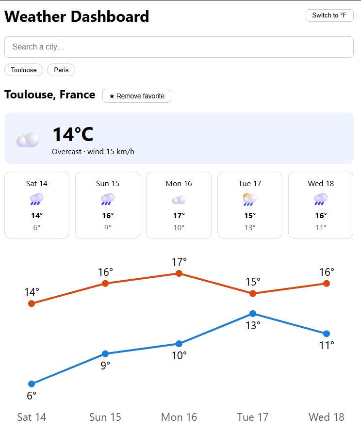

# Weather Dashboard

[](https://github.com/bbaost/weather-dashboard-angular/actions/workflows/ci.yml)

A weather dashboard built with Angular and NgRx: search a city, see the current conditions and a 5-day forecast, save favorites, and switch between °C and °F.

**[Live demo](https://weather.baptisteallex.com/)**



## Features

- City search with debounced autocomplete (Open-Meteo geocoding)
- Current conditions and 5-day forecast
- Temperature chart (max/min), drawn in inline SVG
- Favorite cities, persisted in localStorage
- °C / °F toggle
- Loading, error and empty states

## Tech stack

Angular (standalone components, signals), TypeScript (strict), NgRx (store, effects, `createFeature`), RxJS, Vitest, ESLint, Prettier, GitHub Actions (CI and deployment to GitHub Pages).

## Technical choices

- **NgRx for state.** The selected city, forecast, loading/error state, favorites and unit live in one store. Components only read signals from selectors and dispatch actions. Side effects (HTTP calls, saving favorites) are isolated in effects.
- **RxJS for search.** `debounceTime`, `distinctUntilChanged` and `switchMap` avoid unnecessary requests and cancel outdated ones.
- **Typed API layer.** Open-Meteo responses are typed and mapped to the app's own models, so the UI doesn't depend on the API's response shape.
- **No chart library.** The chart is a small SVG component, which keeps the bundle light and the component easy to test.
- **CI/CD.** Every push runs lint, tests and build, and `master` is deployed automatically to GitHub Pages.

## Getting started

```bash
git clone https://github.com/bbaost/weather-dashboard-angular.git
cd weather-dashboard-angular
npm install
npm start
```

Open http://localhost:4200.

```bash
npm run lint
npm test
npm run build
```

## Data

Weather data by [Open-Meteo](https://open-meteo.com/) (CC BY 4.0). No API key required.